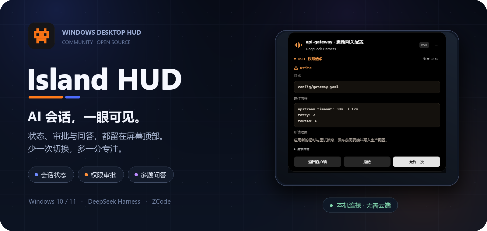

<div align="center">

<sub><a href="README.md">简体中文</a> · <b>English</b></sub>

<br />



<br />

**Keep sessions, approvals, and questions at the edge of your vision.**

<p>
  <a href="https://github.com/Angelyeye/island-hud/actions/workflows/ci.yml"></a>
  
  
  
  
</p>

<p>
  <a href="#features">Features</a> ·
  <a href="#screenshots">Screenshots</a> ·
  <a href="#quick-start">Quick start</a> ·
  <a href="#install-integrations">Install integrations</a> ·
  <a href="#how-it-works-and-privacy">Privacy by design</a> ·
  <a href="#frequently-asked-questions">FAQ</a> ·
  <a href="#contributing">Contributing</a>
</p>

</div>

Island HUD is an island-shaped card that lives at the top of your Windows screen: it collapses into a narrow strip while idle and expands into an approval or question card when a decision is needed. Allow once, deny, or pick an answer — no more switching back to the terminal to hunt for the window that is waiting on you.

It merges sessions from **DeepSeek Harness (DSH, via native plugin)** and **ZCode (via hook configuration)** into a single list, so the runtime status, pending requests, and finished results of both clients stay visible on the same island.

> [!IMPORTANT]
> **Unofficial notice**: Island HUD is an independent community open-source project. It is not affiliated with DeepSeek, ZCode, or any other product, company, or team, and it has not received endorsement, authorization, or support from any of them in any form.

---

## Features

| ◉ At a glance | ⚡ Decide in place | 🗂 Manage as you go |
| --- | --- | --- |
| **Session status**<br>Current session, project, tools, and run state — visible at a glance.<br><br>**Completion alerts**<br>A light hint when a task finishes; open it for the summary of that turn.<br><br>**Multi-session browsing**<br>Pending and running sessions come first, and the compact list holds more of them. | **Single approval**<br>Allow once, deny, or return to the client — the result goes back the way it came.<br><br>**Multi-question prompts**<br>Single choice, multiple choice, or free text; drafts are saved per question, and Chinese IME input works as expected.<br><br>**Non-blocking continuation**<br>The request keeps waiting in the background after the card collapses, so you can answer later. | **Precise jump**<br>Click a card to land in the DSH session; a ZCode session opens its project directory.<br><br>**Archive and delete**<br>Hides things locally only — no client data is deleted, and everything can be restored.<br><br>**Adjustable appearance**<br>Density, font size, maximum height, and theme all preview live on the settings page. |

## Screenshots

| Overview · runtime state at a glance | Sessions · pending first |
| :---: | :---: |
|  |  |
| <sub>Running, waiting for approval, completed, and idle, all in one place.</sub> | <sub>Pending first, most recently active on top, so the target session is quick to find.</sub> |

<p align="center">
  
  <br />
  <sub><b>Integration settings</b> · DSH and ZCode each show their connection status and version; install, repair, and uninstall are one click each.</sub>
</p>

## Supported clients

| Client | Integration | On-island capabilities | Session jump |
| --- | --- | --- | --- |
| **DeepSeek Harness** | Local native plugin | Session status · permission approval · multi-question prompts<br><sub>supports timed non-blocking mode</sub> | Jumps to the exact session |
| **ZCode** | Writes hook configuration | Session status · permission approval · multi-question prompts<br><sub>answers are returned through the approval surface, experimental</sub> | Opens the project directory of the session |

Both clients share the same loopback channel and the same island. The list sorts pending work first, with the most recently active on top; when one client has many sessions, up to 50 are shown at a time.

## Quick start

### Option 1: download a release

**[→ Get a release from Releases](https://github.com/Angelyeye/island-hud/releases)**. Every release ships:

| File | Best for |
| --- | --- |
| `IslandHUD-<version>-DSH-portable-x64.zip` | **Portable use**: unzip and run `IslandHUD.exe`, no Node.js install needed |
| `IslandHUD-<version>-DSH-Setup-x64.exe` | **Installed use**: per-user install, supports in-place upgrade and uninstall |
| `SHA256SUMS.txt` | **Integrity check**: SHA-256 checksums for every artifact |

> [!NOTE]
> The latest release is **v0.2.0** (DSH + ZCode): ZCode support, a fix for auto-hide on fullscreen, and a runtime upgrade to Electron 42. To upgrade from v0.1.0, simply install over it — settings and integration config are preserved.

Release artifacts **are not code-signed yet**, so Windows SmartScreen may warn about an unknown publisher. Verify `SHA256SUMS.txt` with `Get-FileHash` before running anything; see the [code signing policy](#code-signing-policy) for progress.

### Option 2: run from source

```powershell
git clone https://github.com/Angelyeye/island-hud.git
cd island-hud
npm ci
npm run build:helpers
npm start
```

- `npm ci` installs dependencies strictly from the lockfile. If the Electron binary download is restricted, point `$env:ELECTRON_MIRROR` at a mirror temporarily.
- `npm run build:helpers` uses the .NET Framework 4 compiler bundled with Windows to build `tools/pipe-host.cs` into the pipe helper, and rebuilds it automatically after source changes.
- `npm start` is **isolated development mode**: it uses a separate `work/development` configuration and data directory and never touches the DSH / ZCode configuration and model permissions you actually use. For real use, install the matching integration from the settings page.

> [!TIP]
> **Requirements**: Windows 10 / 11 (x64), Node.js 24 (npm included), Electron (exact version pinned by `package.json`), and a `csc.exe` able to build the pipe helper.

## Install integrations

Open the tray icon context menu → **Settings…** (设置…), then switch to the **Integrations** (集成) page.

### DeepSeek Harness · native plugin

1. Make sure the DSH card reports a connectable status.
2. Click **Install / Repair** (安装 / 修复) and wait for the write to finish; every operation backs up the existing configuration first.
3. Restart DSH normally so the plugin takes effect.

The plugin writes to the DSH configuration in a managed way. Uninstalling is a single click on **Uninstall integration** (卸载集成) and never deletes DSH's own session data. DSH's plugin extension points are not publicly stable yet, so upgrading DSH may require a matching plugin update.

### ZCode · hook configuration

1. Make sure the ZCode card is clickable and choose **Install / Repair** (安装 / 修复).
2. Installation writes the hooks added by this integration into the ZCode user configuration (`~/.zcode/cli/config.json`): it backs up first and only touches the entries this integration owns.
3. Start a new ZCode session for it to take effect: session status, permission approvals, and questions then appear on the island.
4. To remove it, click **Uninstall integration** (卸载集成); only the hook entries added by this integration are removed.

<details>
<summary><b>ZCode compatibility, fallback, and conflict notes</b></summary>

<br />

- Hook scripts are executed by `node`, so make sure Node.js is on your PATH.
- While an approval card is open, the native ZCode command waits for the decision on the island. If Island HUD exits or stops responding for a long time, it falls back to the native ZCode approval and the session never hangs. ZCode approval / question cards can wait for up to 24 hours.
- Read-only tools (Read / Glob / Grep, etc.) and auto-approve mode are not proxied and behave exactly as native.
- Returning answers through the approval surface (`updatedInput`) is an experimental protocol; on failure it falls back to the native ZCode UI.
- If you also run another hook that blocks on `PermissionRequest` (for example another approval bridge), both will wait for a response. The settings page reports the conflict — disable one of them as needed.

</details>

## How it works and privacy

```text
DSH plugin (native plugin) / ZCode (hook configuration)
        │  listens on 127.0.0.1 only, fresh one-time token per launch
        ▼
Island HUD  ──▶  top island · settings page · tray · global hotkeys
```

| Design | Behavior |
| --- | --- |
| **Loopback only** | The bridge service listens on `127.0.0.1` only — never on LAN or public addresses, and never through any third-party service. |
| **One-time token** | A 192-bit local token is generated on every launch and stored only in the current user's configuration directory; every request must carry it. |
| **Tightened permissions** | Access control on the configuration directory and the token file is tightened at startup (`icacls`), and the pipe helper uses an explicit DACL so other users on the same machine cannot borrow the channel. |
| **No telemetry** | No telemetry, no crash reporting. The only network access is an update check you can disable (it is off by default). |
| **Automatic backups** | Integrations back up before installing and only modify their own entries, never other plugins or hooks. |

Local data lives in `%LOCALAPPDATA%\IslandHUD`:

| Content | Notes |
| --- | --- |
| Settings and integration descriptors | Unpack one descriptor file and you're connected — no hand-written ports |
| Archive / delete records | Only stores the session keys hidden on the island, capped at 500 entries / 30 days; new activity restores a session automatically |
| Logs | Diagnostic logs rotate by size; strip personal information such as local paths before sharing diagnostics |

## Shortcuts and settings

| Shortcut | Action |
| --- | --- |
| <kbd>Ctrl</kbd> + <kbd>Alt</kbd> + <kbd>I</kbd> | Show / hide the island |
| <kbd>Ctrl</kbd> + <kbd>Alt</kbd> + <kbd>O</kbd> | Expand / collapse the full session panel |
| <kbd>Esc</kbd> | Collapse the currently expanded panel (does not deny or cancel the original request) |
| <kbd>Ctrl</kbd> + <kbd>Enter</kbd> | Confirm submission on the question review page (not triggered while an IME composition is active) |

The tray context menu also offers: re-center, switch display, auto-hide in fullscreen, open the log directory, and copy diagnostics. The settings page has five tabs — **General / Display and motion / Integrations / Shortcuts / Diagnostics and about** (通用 / 显示与动效 / 集成 / 快捷键 / 诊断与关于) — and appearance changes preview live.

## Frequently asked questions

<details>
<summary><b>The ZCode card keeps showing “waiting for connection”?</b></summary>

Hooks are executed by `node`: first confirm `node` is on your PATH, then start a new ZCode session (hooks load when a session starts). If you have not opened a new session since installing, the card stays in the waiting state — that is expected behavior.
</details>

<details>
<summary><b>Why does Windows say “unknown publisher”?</b></summary>

The artifacts are not code-signed yet, so SmartScreen may block the first run. Check the hashes in `SHA256SUMS.txt` first, then choose **Run anyway**. The project is applying for free open-source signing from the SignPath Foundation; releases will be signed gradually once it is approved.
</details>

<details>
<summary><b>Does it upload session content to the cloud?</b></summary>

No. The integration and the app only talk over a local loopback channel; the project has no telemetry and no cloud sync. The only outbound request is the update check you can disable (it fetches a version manifest only).
</details>

<details>
<summary><b>Does archiving or deleting a session remove client data?</b></summary>

No. Archive and delete only affect what the island shows: records stay on this machine and can be restored any time from **Diagnostics and about** (诊断与关于). The client's own session files, history, and profile are untouched.
</details>

<details>
<summary><b>Are macOS / Linux, Claude Code, or other clients supported?</b></summary>

Only DSH and ZCode on Windows 10 / 11 are supported today. Other systems and clients are out of scope, with no roadmap commitment.
</details>

## Known limitations

- DSH's plugin extension points are not publicly stable yet, so a DSH upgrade may require a plugin update; the ZCode integration likewise depends on its hook configuration format.
- Returning ZCode answers through the approval surface is an experimental protocol and falls back to the native UI on failure.
- Artifacts are unsigned, so SmartScreen may warn.
- The project is at an early experimental stage; interfaces and UI may still change.
- Automated tests cover the Node layer; GUI and tray behavior need manual verification on a real desktop.

## Development and testing

```powershell
npm test          # Node unit and integration tests; the only suite CI runs
npm run test:ui   # GUI checks that need a real desktop
npm run test:tray # tray menu checks
```

### Brand assets

The official mark is **Pixel Console**: a blue pixel terminal frame with a command prompt and an activity waveform, plus a single orange response light in the top-right corner. The vector source, standalone graphics, PNGs at every size, the Windows ICO, and the usage guidelines live in [`design/logo/`](design/logo/README.md).

After changing the logo, regenerate and sync every brand asset from the repository root:

```powershell
npm run build:icon
python design/logo/verify_exports.py
```

`build:icon` updates the README hero image, the packaging icons in `build/`, and the runtime icons in `src/renderer/assets/` in one pass; it needs Microsoft Edge on Windows. Installers that were already built do not change — rebuild to pick up the new icon.

<details>
<summary><b>Repository structure</b></summary>

```text
island-hud/
├─ src/
│  ├─ main.js              Electron main process: windows, tray, island, global hotkeys
│  ├─ preload.js           Controlled bridge between renderer and main processes
│  ├─ app/                 App lifecycle, settings, DSH and ZCode integration management
│  ├─ bridge/              Local loopback service that receives and returns integration requests
│  ├─ dsh/                 DSH adapter layer, session management and navigation
│  ├─ integrations/        Build inputs for the DSH plugin package and ZCode hook
│  ├─ renderer/            Island and settings page UI
│  ├─ sessions/            Session store, archive and visibility
│  ├─ tools/               Runtime helper binaries (build output)
│  └─ update/              Update check
├─ integrations/           Generated DSH plugin package and ZCode hook client
├─ tools/                  Build, packaging, test and release scripts (including the C# helper source)
├─ test/                   Node-layer tests
├─ screenshots/            README hero image and UI screenshots
├─ design/logo/            Pixel Console brand sources and export scripts
├─ build/                  Packaging configuration and Windows icons
└─ .github/                CI, DCO, issue templates and security policy
```
</details>

## Contributing

Issues and improvements are welcome, and so are pull requests:

- Read the [contributing guide](.github/CONTRIBUTING.md) first; every commit needs a `Signed-off-by` line (DCO — `git commit -s` is enough).
- `main` is a protected branch; changes land through pull requests and must pass three checks: `Node tests (Windows)`, `Secret scan`, and `DCO`.
- Report security issues privately through Private Vulnerability Reporting as described in the [security policy](.github/SECURITY.md); do not disclose details in a public issue.
- Never commit tokens, certificates, local paths, real session records, or third-party assets.

## Code signing policy

Free code signing provided by [SignPath.io](https://about.signpath.io), certificate by [SignPath Foundation](https://signpath.org).

- Committers and reviewers: [Angelyeye](https://github.com/Angelyeye)
- Approvers: [Angelyeye](https://github.com/Angelyeye)

The project is applying for free open-source signing from the SignPath Foundation; **until the application is approved and the first signed release ships, every release artifact is unsigned**. See the [Code signing policy](.github/CODE_SIGNING_POLICY.md) for signing scope, verification, and privacy details.

## License

This project is released under the **GNU Affero General Public License v3.0** (AGPL-3.0-only), copyright **Angelyeye**; the full terms are in [LICENSE](LICENSE). Third-party dependencies and their licenses are listed in [NOTICE](NOTICE); `integrations/dsh/preset-standard.patch.yml` is modified from an MIT-licensed DeepSeek DSH preset, and the copyright and license notice is in the file header and in NOTICE.

See [CHANGELOG.md](CHANGELOG.md) for the changelog.

---

<div align="center">

[](https://github.com/deepseek-ai/deepseek-harness)

<br /><br />

<sub>If this island helps your workflow, a ⭐ Star is welcome.</sub>
<br />
<sub>Keep information at the edge of your vision, keep focus in the current window.</sub>

</div>
