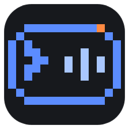
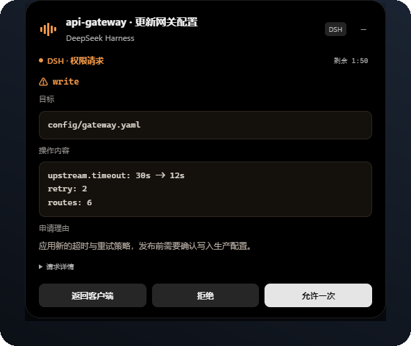
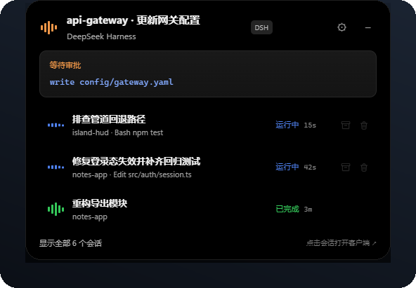
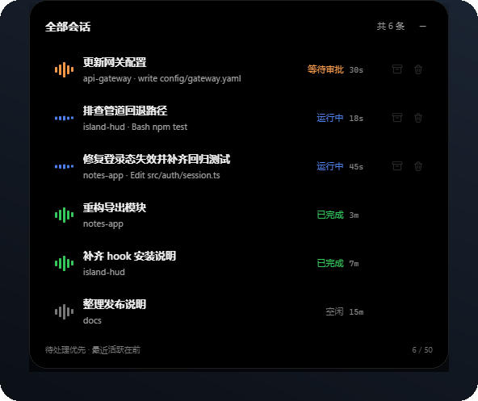
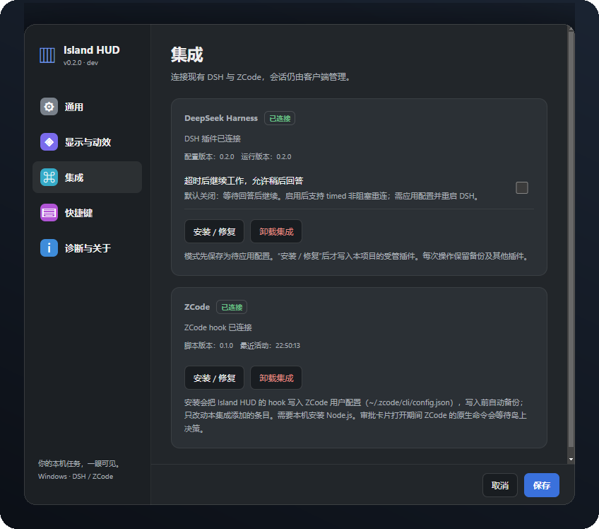

<div align="center">



# Island HUD

**Windows 顶部的悬浮岛式 HUD —— 让 DeepSeek Harness 与 ZCode 的会话、审批和问答，一直待在你的视野边缘。**

<p>
  <a href="https://github.com/Angelyeye/island-hud/actions/workflows/ci.yml"></a>
  
  
  
  
</p>

<p>
  <a href="#界面预览">界面预览</a> ·
  <a href="#支持的客户端">支持的客户端</a> ·
  <a href="#功能特性">功能特性</a> ·
  <a href="#快速开始">快速开始</a> ·
  <a href="#安装集成">安装集成</a> ·
  <a href="#工作原理与隐私">工作原理与隐私</a> ·
  <a href="#参与贡献">参与贡献</a>
</p>

</div>

岛形卡片常驻屏幕顶部，空闲时收成一条窄边。需要你决策时，它自动展开成审批或问答卡片 —— 允许一次、拒绝、或者选一个答案，都在岛上完成，不必切回终端翻找那个正在等你的窗口。

它把 **DeepSeek Harness（下称 DSH，原生插件接入）** 与 **ZCode（hook 配置接入）** 的会话合并在同一个列表里：同一个岛上，两类客户端的运行状态、待处理请求和完成结果一视同仁。

> [!IMPORTANT]
> **非官方声明**：Island HUD 是独立的社区开源项目，与 DeepSeek、ZCode 及其他任何产品、公司、团队均无关联，也未获得任何形式的背书、授权或支持。

<p align="center">
  
  <br />
  <sub>权限请求直接在岛上等待决策：允许一次、拒绝或返回客户端，会话在后台继续。</sub>
</p>

---

## 界面预览

<p align="center">
  
  &nbsp;&nbsp;
  
  <br />
  <sub>左：总览卡片，运行中 / 等待审批 / 已完成 / 空闲一眼可见。右：全部会话，待处理优先、最近活跃在前。</sub>
</p>

<p align="center">
  
  <br />
  <sub>设置页 · 集成：DSH 与 ZCode 各自显示连接状态、版本，安装 / 修复 / 卸载只需一次点击。</sub>
</p>

## 支持的客户端

| 客户端 | 接入方式 | 会话状态 | 权限审批 | 多题问答 | 会话跳转 |
| --- | --- | :--: | :--: | :--: | --- |
| **DeepSeek Harness** | 本机原生插件 | ✅ | ✅ | ✅ 支持 timed 非阻塞 | 精确定位到对应会话 |
| **ZCode** | 写入 hook 配置 | ✅ | ✅ | ✅ 答案经审批面回传（实验性） | 打开会话所在项目目录 |

两类客户端共用同一套回环通道与同一块岛，列表里按待处理优先、最近活跃在前排序；同一客户端有多个会话时，最多同时展示 50 条。

## 功能特性

| ◉ 一眼看清 | ⚡ 就地决策 | 🗂 顺手管理 |
| --- | --- | --- |
| **会话状态**：当前会话、项目、当前工具与运行状态，空闲时自动收起为窄条。<br>**完成提醒**：任务结束给一次轻提示，点开即是本轮摘要。<br>**多会话浏览**：待处理与运行中优先，全部会话面板为紧凑滚动列表。 | **单次审批**：允许一次、拒绝、返回客户端，结果原路回传给 DSH / ZCode。<br>**多题问答**：单选、多选、自由文本，逐题保存草稿，兼容中文输入法。<br>**非阻塞接续**：卡片收起后请求仍在后台等待，稍后回答也不迟。 | **精确跳转**：点卡片直接进入 DSH 会话；ZCode 会话打开其项目目录。<br>**归档与删除**：只在本机隐藏，不删除客户端数据，随时可恢复。<br>**外观可调**：面板密度、字号、最大高度、主题，设置页内实时预览。 |

## 快速开始

### 直接使用发布版

公开产物见 [Releases](https://github.com/Angelyeye/island-hud/releases)。每个版本提供：

| 文件 | 说明 |
| --- | --- |
| `IslandHUD-<版本>-DSH-portable-x64.zip` | 便携版，解压后直接运行 `IslandHUD.exe`，无需安装 Node.js |
| `IslandHUD-<版本>-DSH-Setup-x64.exe` | NSIS 安装器，当前用户安装，支持覆盖升级与卸载 |
| `SHA256SUMS.txt` | 所有产物的 SHA-256 校验值 |

> [!NOTE]
> 目前公开 Release 为 **v0.1.0**（仅 DSH）；**ZCode 支持已合入 `main`（v0.2.0）**，发布产物上线后本节会同步更新。想立刻体验 ZCode，请按下一节从源码运行。

发布产物**尚未做代码签名**，Windows SmartScreen 可能提示未知发布者。请先用 `Get-FileHash` 核对 `SHA256SUMS.txt` 再运行；签名进度见 [代码签名策略](#代码签名策略)。

### 从源码运行

```powershell
git clone https://github.com/Angelyeye/island-hud.git
cd island-hud
npm ci
npm run build:helpers
npm start
```

- `npm ci` 严格按锁文件安装依赖；Electron 二进制下载受限时，可临时设置 `$env:ELECTRON_MIRROR` 指向镜像。
- `npm run build:helpers` 调用 Windows 自带的 .NET Framework 4 编译器，把 `tools/pipe-host.cs` 编译成管道助手；源码变更后会自动重建。
- `npm start` 是**隔离开发模式**：使用独立的 `work/development` 配置与数据目录，不会改动你正在使用的 DSH / ZCode 配置与模型权限。正式使用请在设置页安装对应集成。

**环境要求**：Windows 10 / 11（x64）、Node.js 24（自带 npm）、Electron（版本由 `package.json` 精确锁定）、可用的 `csc.exe`（用于构建管道助手）。

## 安装集成

打开托盘图标右键菜单 →「设置…」，切到 **集成** 页。

### DeepSeek Harness

1. 确认 DSH 卡片状态为可连接。
2. 点击「安装 / 修复」，等待写入完成；每次操作都会先备份现有配置。
3. 正常重启 DSH 让插件生效。

插件按受管方式写入 DSH 配置，卸载时点击「卸载集成」即可，不会删除 DSH 自身的会话数据。DSH 的插件扩展点尚未公开稳定，升级 DSH 后可能需要同步更新插件。

### ZCode

1. 确认 ZCode 卡片可点击，选择「安装 / 修复」。
2. 安装把本集成添加的 hook 写入 ZCode 用户配置（`~/.zcode/cli/config.json`）：写入前自动备份，只改动本集成添加的条目。
3. 重新发起一个 ZCode 会话即生效：会话状态、权限审批与提问会出现在岛上。
4. 卸载时点击「卸载集成」，只移除本集成添加的 hook 条目。

说明：

- hook 脚本由 `node` 执行，请确保 Node.js 在 PATH 中。
- 审批卡片打开期间，ZCode 的原生命令会等待岛上决策；退出 Island HUD 或长时间不响应时自动回退 ZCode 原生审批，不会卡死会话。ZCode 审批 / 问答卡片最长可等待 24 小时。
- 只读工具（Read / Glob / Grep 等）与自动批准模式不会中转，行为与原生一致。
- 问答经审批面回传答案（`updatedInput`）属实验性协议，失败时自动回退 ZCode 原生界面。
- 若还安装了其他会在 `PermissionRequest` 上阻塞的 hook（例如别的审批桥），两者会同时等待响应；设置页会提示冲突，按需停用其一。

## 工作原理与隐私

```text
DSH 插件  ─┐                  ┌─ 顶部悬浮岛（会话 / 审批 / 问答）
           ├─ 127.0.0.1 回环 ──┤
ZCode hook ┘  一次性令牌校验    └─ 设置页 / 托盘 / 全局热键
```

- 桥接服务**只监听 `127.0.0.1`**，不监听局域网或公网地址，也不经过任何第三方服务。
- 每次启动生成一次性 192-bit 本机令牌，仅保存在当前用户配置目录；请求必须携带令牌。
- 配置目录与令牌文件的 ACL 在启动时收紧（`icacls`），管道助手使用显式 DACL，避免同机其他用户借用通道。
- 应用**不收集遥测**，不做崩溃上报；唯一的联网行为是可关闭的更新检查（默认关闭）。
- 集成安装前自动备份，且只修改本集成自己的条目，不改动你其他的插件或 hook。

本机数据存放于 `%LOCALAPPDATA%\IslandHUD`：

| 内容 | 说明 |
| --- | --- |
| 设置与集成描述符 | 解压一个描述文件即可接入，无需手工写端口 |
| 归档 / 删除记录 | 只记录"在岛上隐藏"的会话键，最多保留 500 条 / 30 天；有新活动会自动恢复 |
| 日志 | 诊断日志按大小轮转；复制诊断信息前请自行移除本机路径等个人信息 |

## 快捷键与设置

| 快捷键 | 作用 |
| --- | --- |
| `Ctrl + Alt + I` | 显示 / 隐藏悬浮岛 |
| `Ctrl + Alt + O` | 展开 / 收起全部会话面板 |
| `Esc` | 收起当前展开的面板（不会拒绝或取消原请求） |
| `Ctrl + Enter` | 问答检查页确认提交（输入法组合期间不触发） |

托盘右键菜单还可以：重新居中、切换显示器、设置全屏自动隐藏、打开日志目录、复制诊断信息。设置页包含 **通用 / 显示与动效 / 集成 / 快捷键 / 诊断与关于** 五页，外观调整带实时预览。

## 常见问题

<details>
<summary><b>ZCode 卡片一直显示「等待连接」？</b></summary>

hook 由 `node` 执行：先确认 `node` 在 PATH 中，再重新发起一个 ZCode 会话（hook 在会话启动时加载）。如果刚装完还没开新会话，卡片会停留在等待状态，这是预期行为。
</details>

<details>
<summary><b>为什么 Windows 提示「未知发布者」？</b></summary>

当前产物未做代码签名，SmartScreen 可能拦截首次运行。请先核对 `SHA256SUMS.txt` 中的哈希，再选择"仍要运行"。项目正在申请 SignPath Foundation 的免费开源签名，通过后发布产物会逐步签名。
</details>

<details>
<summary><b>会不会把会话内容上传到云端？</b></summary>

不会。集成与应用之间只走本机回环通道；项目没有遥测和云同步。唯一的对外请求是可关闭的更新检查（只拉取版本清单）。
</details>

<details>
<summary><b>归档或删除会话，会删掉客户端的数据吗？</b></summary>

不会。归档与删除只影响岛上的显示：记录保存在本机，随时可在「诊断与关于」里恢复；客户端自己的会话文件、历史与 profile 都不变。
</details>

<details>
<summary><b>支持 macOS / Linux、Claude Code 或其他客户端吗？</b></summary>

当前只支持 Windows 10 / 11 上的 DSH 与 ZCode。其他系统与客户端不在支持范围内，也没有排期承诺。
</details>

## 已知限制

- DSH 的插件扩展点尚未公开稳定，DSH 升级后可能需要同步更新插件；ZCode 集成同理依赖其 hook 配置格式。
- ZCode 问答经审批面回传属实验性协议，失败时回退原生界面。
- 产物未签名，SmartScreen 可能提示风险。
- 项目处于早期实验阶段，接口与界面仍可能调整。
- 自动化测试覆盖 Node 层逻辑；GUI 与托盘行为需要真实桌面手动验证。

## 测试与目录结构

```powershell
npm test          # Node 层单元与集成测试，CI 只跑这一项
npm run test:ui   # 需要真实桌面的 GUI 检查
npm run test:tray # 托盘菜单检查
```

<details>
<summary><b>目录结构</b></summary>

```text
island-hud/
├─ src/
│  ├─ main.js              Electron 主进程：窗口、托盘、悬浮岛与全局快捷键
│  ├─ preload.js           渲染进程与主进程之间的受控桥
│  ├─ app/                 应用生命周期、设置、DSH 与 ZCode 集成管理
│  ├─ bridge/              本机回环服务，接收并回传集成请求
│  ├─ dsh/                 DSH 适配层、会话管理与导航
│  ├─ integrations/        DSH 插件包与 ZCode hook 的构建素材
│  ├─ renderer/            悬浮岛与设置页界面
│  ├─ sessions/            会话存储、归档与可见性
│  ├─ tools/               运行时助手二进制（构建产物）
│  └─ update/              更新检查
├─ integrations/           生成的 DSH 插件包与 ZCode hook 客户端
├─ tools/                  构建、打包、测试与发布脚本（含 C# 助手源码）
├─ test/                   Node 层测试
├─ screenshots/            README 界面截图
├─ build/                  打包配置与图标素材
└─ .github/                CI、DCO、Issue 模板与安全策略
```
</details>

## 参与贡献

欢迎提交问题与改进，也欢迎直接开 PR：

- 提交前请读 [贡献指南](.github/CONTRIBUTING.md)；每个 commit 需要包含 `Signed-off-by` 行（DCO，`git commit -s` 即可）。
- `main` 是受保护分支，改动通过 PR 合入，并需要 `Node tests (Windows)`、`Secret scan`、`DCO` 三项检查通过。
- 安全问题请按 [安全策略](.github/SECURITY.md) 通过 Private Vulnerability Reporting 私下上报，不要在公开 Issue 中披露细节。
- 请勿提交令牌、证书、本机路径、真实会话记录或第三方素材。

## 代码签名策略

Free code signing provided by [SignPath.io](https://about.signpath.io), certificate by [SignPath Foundation](https://signpath.org).

- Committers and reviewers: [Angelyeye](https://github.com/Angelyeye)
- Approvers: [Angelyeye](https://github.com/Angelyeye)

目前正在申请 SignPath Foundation 免费开源签名；**在申请通过并发布首个签名版本前，所有发布产物均为未签名状态**。签名覆盖范围、验证方式与隐私说明见 [Code signing policy](.github/CODE_SIGNING_POLICY.md)。

## 许可证

本项目以 **GNU Affero General Public License v3.0**（AGPL-3.0-only）发布，版权归 **Angelyeye** 所有，完整条款见 [LICENSE](LICENSE)。第三方依赖及其许可见 [NOTICE](NOTICE)；其中 `integrations/dsh/preset-standard.patch.yml` 基于 DeepSeek DSH 的 MIT 许可 preset 修改，版权与许可声明见该文件头及 NOTICE。

更新记录见 [CHANGELOG.md](CHANGELOG.md)。

---

<div align="center">

[](https://github.com/deepseek-ai/deepseek-harness)

<sub>如果这个小岛对你的工作流有用，欢迎点一个 ⭐ Star。</sub>

</div>
