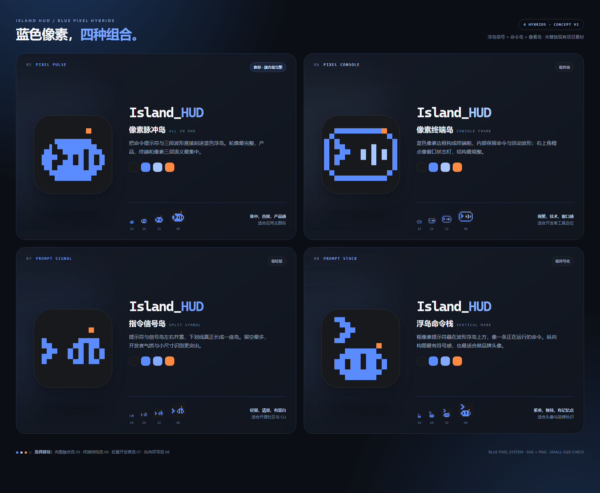

# Island HUD Logo · 蓝色像素融合概念 V2

第二轮按照反馈，以**蓝色像素语言作为统一基底**，继续融合第一轮的三条线索：**01 浮岛信号**的悬浮胶囊、活动波形和回应灯，**03 命令岛**的终端提示符，以及 **04 像素岛**的阶梯像素轮廓。

> **定稿结果：采用 06 · Pixel Console / 像素终端岛。** 正式资源已整理到 `design/logo/`，并同步到 README、设置页、托盘、窗口与 Windows 打包图标。本目录保留四套方案作为选型记录，第一轮概念也继续保留。



## 方案速选

| 编号 | 方向 | 构图与特点 | 更适合 |
| --- | --- | --- | --- |
| **05 · Pixel Pulse / 像素脉冲岛** | 一体化横向胶囊 | 提示符与三段波形直接刻进蓝色浮岛，融合信息最完整 | **应用主图标首选**，产品界面、README |
| **06 · Pixel Console / 像素终端岛** | 像素终端外框 | 蓝色边框包裹命令和浅蓝波形，右上橙点像窗口状态灯 | 强调终端、窗口和开发者工具属性 |
| **07 · Prompt Signal / 指令信号岛** | 左右分体 | 提示符与信号小岛并置，留白最多，构图在小尺寸下最轻 | **开源社区、CLI、开发者文档** |
| **08 · Prompt Stack / 浮岛命令栈** | 上下堆叠 | 粗提示符位于波形浮岛上方，唯一的纵向符号结构 | 品牌头像、社交账号、方形标识 |

**推荐顺序：05 → 07 → 06 → 08。**

- 想在一枚图标里同时看清“浮岛 + 波形 + 命令”，选 **05**。
- 想让开发者气质更轻、更直接，选 **07**。
- 想强调“这是一个终端工作流工具”，选 **06**。
- 想要更独特的纵向品牌符号，选 **08**。

## 统一视觉语言

| 颜色 | 色值 | 用途 |
| --- | --- | --- |
| 深炭黑 | `#17191D` | 图标底座、负形命令与波形 |
| 主蓝 | `#5B8CFF` | 四套方案统一的像素主形 |
| 浅蓝 | `#A9C7FF` | 06 的活动波形与层级变化 |
| 回应橙 | `#FF8A42` | 小面积回应灯，不再承担主色 |

内部图形使用 64 单位网格：在 16 px 导出时，一个网格单位对应一个物理像素；24 px 等非整数倍尺寸仍由渲染器正常重采样。外层 Windows 圆角底座保留平滑边缘，内部维持像素化造型。

## 文件结构

每个方案目录均包含：

- `icon.svg`：1024 × 1024 视图的可编辑矢量主图标，透明外缘、圆角底座。
- `icon-16.png`、`-24`、`-32`、`-48`、`-64`、`-128`、`-256`、`-512`、`-1024`：实际尺寸 RGBA PNG 导出。

根目录：

- `preview.html` / `preview.png`：四方案对比板，1800 × 1480。
- `validation.html` / `validation.png`：真实小尺寸导出、深浅背景抽查与最近邻放大检查，1800 × 1050。
- `export-previews.cjs`：无 npm 依赖的 Edge 渲染与导出脚本。
- `verify_exports.py`：SVG、PNG 尺寸、透明通道和文件完整性检查。

## 定稿去向

**06 · Pixel Console / 像素终端岛**已被选为正式标识。矢量母版、独立图形、多尺寸 PNG / ICO 与使用规范已整理到 `design/logo/`；README、设置页、托盘、窗口和打包资源均引用正式版本。

本目录不再承担运行时资源来源，后续微调应先修改正式母版，再按需同步回这份历史概念。已有安装包不会自动更新，需重新打包发布。

## 重新导出与验证

从仓库根目录执行：

```powershell
node design/logo-concepts-v2/export-previews.cjs
python design/logo-concepts-v2/verify_exports.py
```

导出脚本需要 Windows Microsoft Edge 与 Node.js 22+；验证脚本需要 Pillow。所有图形均为本组原创几何绘制，不使用第三方 Logo 路径或品牌素材。
