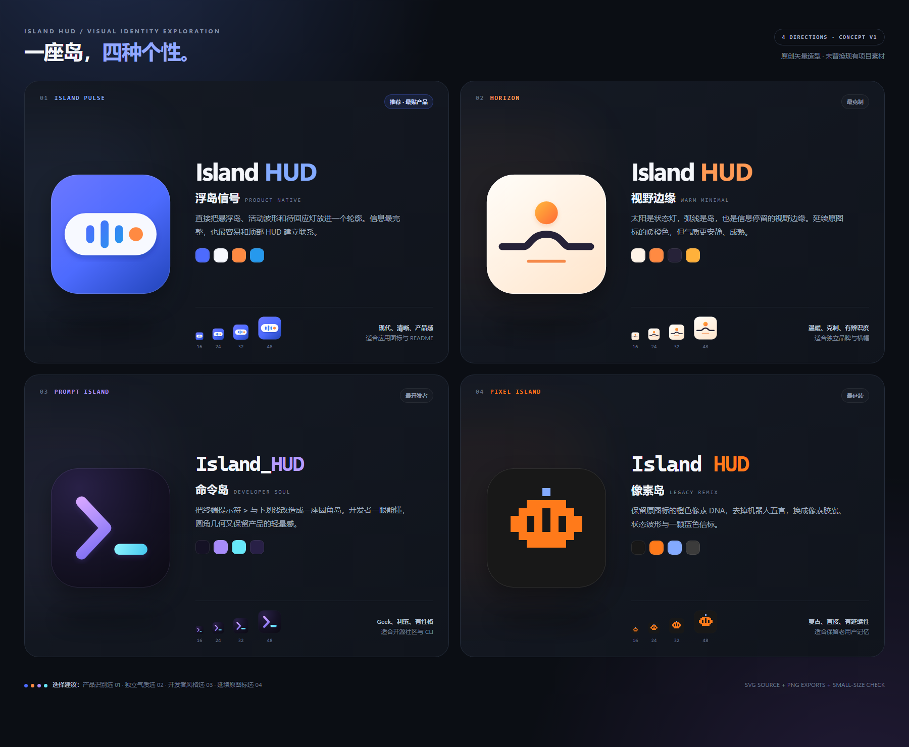

# Island HUD Logo · 四方向概念稿

这组方案从产品的三个核心语义出发：**顶部悬浮岛、AI 会话状态、开发者工作流**。本目录作为第一轮选型记录保留；最终采用第二轮的 **06 · 像素终端岛**，正式资源位于 `design/logo/`。



## 方案速选

| 编号 | 方向 | 核心语义 | 气质 | 更适合 |
| --- | --- | --- | --- | --- |
| **01 · Island Pulse / 浮岛信号** | 白色悬浮胶囊 + 活动波形 + 橙色回应灯 | 最直接对应 Island HUD 产品界面 | 现代、清晰、产品感 | **应用主图标首选**，README、关于页 |
| **02 · Horizon / 视野边缘** | 状态太阳 + 岛屿地平线 | “让信息停在视野边缘” | 温暖、安静、克制 | 独立品牌、宣传横幅、浅色场景 |
| **03 · Prompt Island / 命令岛** | 终端 `>` + 圆角下划线岛 | 开发者工具与终端工作流 | geek、利落、有性格 | 开源社区、CLI、开发者文档 |
| **04 · Pixel Island / 像素岛** | 橙色像素胶囊 + 波形 + 蓝色信标 | 继承原像素机器人的颜色与模块感 | 复古、直接、有延续性 | 保留老用户记忆、像素周边 |

**我的推荐顺序：01 → 03 → 02 → 04。**

- 想让用户“不看名字也知道是那座顶部小岛”，选 **01**。
- 想让开源开发者工具的性格更鲜明，选 **03**。
- 想远离典型 AI/开发者图标，建立更温柔独立的品牌，选 **02**。
- 想让老版本平稳过渡，选 **04**。

## 文件结构

每个方案目录均包含：

- `icon.svg`：1024 × 1024 视图的可编辑矢量主图标，透明外缘、圆角底座。
- `icon-16.png`、`-24`、`-32`、`-48`、`-64`、`-128`、`-256`、`-512`、`-1024`：实际尺寸 PNG 导出。

根目录：

- `preview.html` / `preview.png`：四方案对比板。
- `validation.html` / `validation.png`：真实小尺寸导出与最近邻放大检查。
- `export-previews.cjs`：无 npm 依赖的 Edge 渲染与导出脚本。
- `verify_exports.py`：PNG 尺寸、透明通道和文件完整性检查。

## 定稿去向

本目录仅保留第一轮设计历史。最终正式标识为第二轮 **06 · 像素终端岛**，其矢量母版、多尺寸导出与使用规范位于 `design/logo/`；应用与 README 均从正式品牌目录取用资源。

## 重新导出

从仓库根目录执行：

```powershell
node design/logo-concepts/export-previews.cjs
python design/logo-concepts/verify_exports.py
```

导出脚本需要 Windows Microsoft Edge 与 Node.js 22+；验证脚本需要 Pillow。所有图形均为本组原创几何绘制，不使用第三方 Logo 路径或品牌素材。
