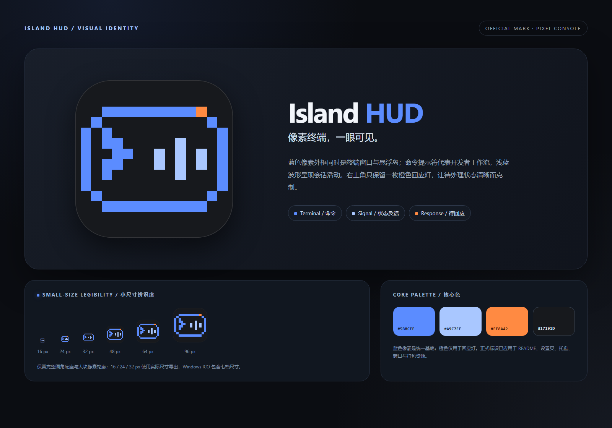

# Island HUD Logo · Pixel Console

正式品牌标识，采用第二轮概念 **06 · 像素终端岛**。蓝色像素终端外框结合命令提示符与活动波形，右上角以一枚橙色像素表示等待回应。



## 设计含义

- **像素终端**：阶梯外框同时表达控制台窗口与悬浮岛，明确产品的开发者工具属性。
- **命令提示符**：左侧 `>` 保留命令行工作流的识别特征。
- **活动波形**：右侧三段浅蓝波形对应会话运行、状态变化与结果反馈。
- **回应灯**：橙色只用于右上角的小面积状态点，不再承担图标主色。
- **Windows 图标底座**：外层圆角保持平滑，内部图形保持像素化；透明外缘适配深色与浅色界面。

本标识由基础几何图形原创绘制，不使用第三方 Logo 路径或品牌素材。

## 正式资源

| 文件 | 用途 |
| --- | --- |
| `island-hud-logo.svg` | 带深炭色圆角底的主图标，唯一矢量母版 |
| `island-hud-mark.svg` | 透明背景的独立像素终端图形，适合横幅与品牌组合 |
| `island-hud-logo.ico` | Windows 图标，包含 16 / 24 / 32 / 48 / 64 / 128 / 256 px |
| `island-hud-logo-16.png` … `island-hud-logo-1024.png` | 16、24、32、48、64、96、128、256、512、1024 px 透明 RGBA PNG |
| `preview.html` / `preview.png` | 正式品牌展示板，1600 × 1120 |
| `validation.png` | 实际小尺寸导出的最近邻放大与深浅背景检查，1400 × 780 |
| `readme-hero.html` | README 主视觉源文件，输出到 `screenshots/hero.png` |
| `export-icons.cjs` | 使用 Edge 渲染 PNG、ICO、品牌板和 README 主视觉，无 npm 依赖 |
| `verify_exports.py` | 使用 Pillow 校验 PNG / ICO 并生成小尺寸检查图 |

## 核心色

| 色彩 | 色值 | 用途 |
| --- | --- | --- |
| Pixel Blue | `#5B8CFF` | 像素终端外框与命令提示符 |
| Signal Blue | `#A9C7FF` | 活动波形 |
| Response Orange | `#FF8A42` | 右上角回应灯 |
| Console Charcoal | `#17191D` | 圆角底座与终端内部 |

## 已接入的位置

| 项目位置 | 正式资源 |
| --- | --- |
| `README.md` / `screenshots/hero.png` | README 主视觉与品牌色彩 |
| `build/icon.ico` | 安装器、卸载器、快捷方式及可执行文件补丁 |
| `build/icon-256.png` | 打包预览图 |
| `src/renderer/assets/icon.svg` | 设置页侧栏品牌标识 |
| `src/renderer/assets/icon-16.png`、`-32`、`-256` | Electron 托盘与窗口图标 |
| `src/main.js` | 托盘、悬浮岛窗口与设置窗口的图标加载 |

`build/` 与 `src/renderer/assets/` 中的品牌文件由同步脚本生成，请修改本目录的 SVG 母版，不要单独编辑副本。重新打包才会更新已发布安装包；正在运行的应用也需要重启后加载新托盘图标。

## 使用规范

- Windows 程序图标优先使用 ICO；GitHub 与文档优先使用 SVG 或 256 / 512 px PNG。
- 主图标四周至少保留图标宽度 **1/8** 的净空，不额外添加描边、投影或文字。
- 16–32 px 场景不要裁掉圆角底；底座能保证图标在不同系统背景中保持稳定边界。
- 独立图形建议最小使用宽度 24 px；更小场景使用完整底座图标。
- 不拉伸、不旋转、不改变橙色回应灯的位置，也不把橙色扩大为主色。

## 重新导出、同步与验证

从仓库根目录执行：

```powershell
npm run build:icon
python design/logo/verify_exports.py
```

等价的分步命令：

```powershell
node design/logo/export-icons.cjs
node tools/make-icon.cjs
python design/logo/verify_exports.py
```

- `export-icons.cjs` 需要 Windows Microsoft Edge 与 Node.js 22+。
- `make-icon.cjs` 使用已提交的正式导出文件，同步运行时与打包资源，无 npm 依赖。
- `verify_exports.py` 需要 Pillow。
- `npm test` 中的品牌一致性测试会检查正式资源、运行时副本、ICO 尺寸和 README 主视觉是否保持同步。

第一轮与第二轮候选方案仍保留在 `design/logo-concepts/` 和 `design/logo-concepts-v2/`，仅作为设计历史记录。
